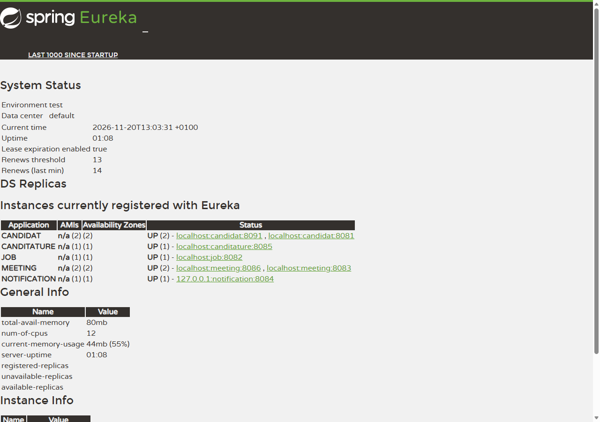
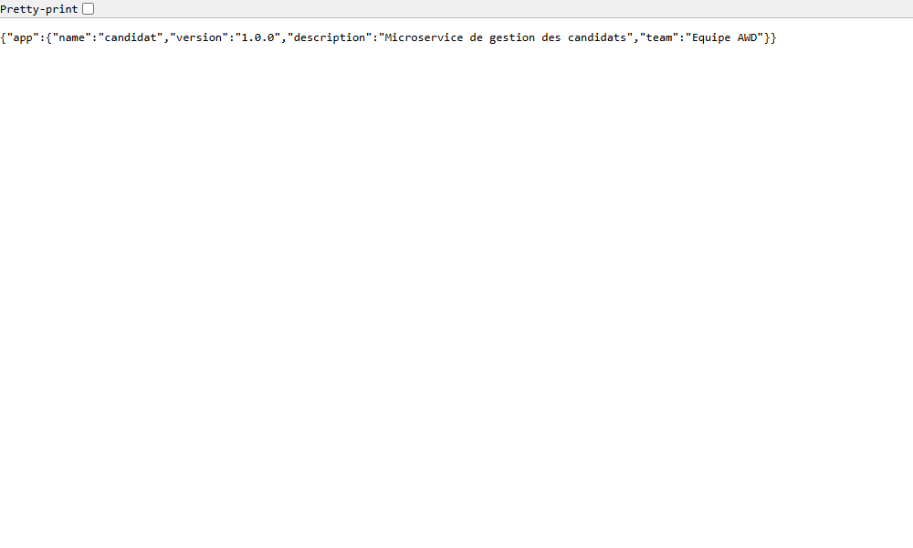
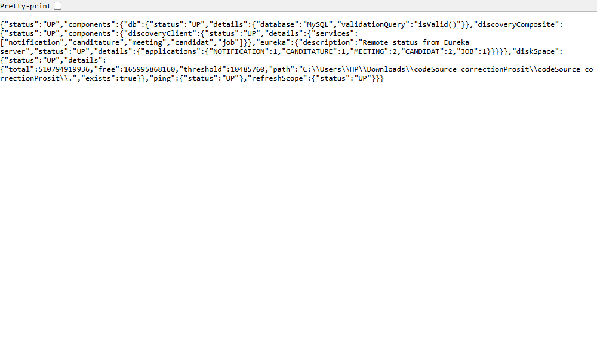
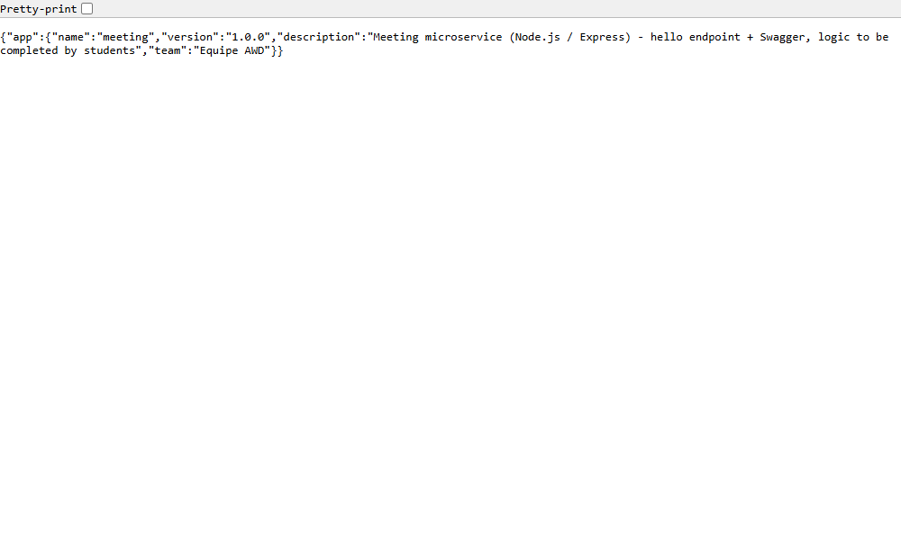
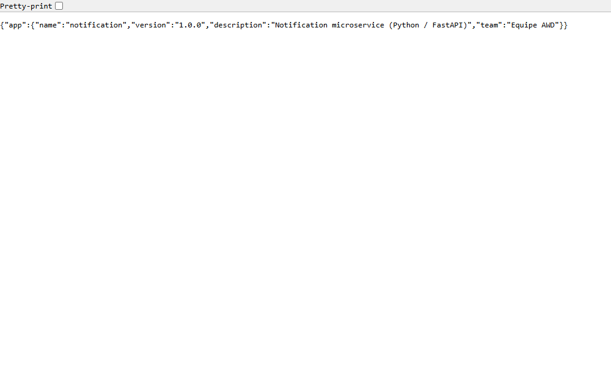

# Architecture Web Distribuée : Eureka Server & Observabilité avec Spring Boot Actuator

Ce projet regroupe les travaux pratiques d'Architecture Web Distribuée :
1. **Atelier 0 : Implémentation « Eureka Server » et microservices polyglottes (Spring Boot, Node.js, Python)**.
2. **Atelier 1 : Observabilité avec Spring Boot Actuator, Health Indicators, Metrics et intégration de la santé dans Eureka**.

---

## 👥 Membres de l'Équipe
- **Étudiant 1** : [Nom & Prénom]
- **Étudiant 2** : [Nom & Prénom]
- **Étudiant 3** : [Nom & Prénom]

---

## 🏗️ Architecture des Microservices

Tous les microservices s'enregistrent auprès du serveur de découverte Eureka (`http://localhost:8761`) et exposent leurs endpoints de santé et d'informations.

| Microservice | Technologie | Port(s) | Nom Eureka | Santé & Actuator |
|---|---|---|---|---|
| **Eureka Server** | Spring Boot | `8761` | `EUREKA` | Registre de découverte et Dashboard |
| **Candidat** | Spring Boot + H2 | `8081`, `8091` | `CANDIDAT` | `/actuator/health`, `/actuator/info`, `/actuator/metrics` |
| **Job** | Spring Boot + MySQL | `8082` | `JOB` | `/actuator/health` (DB MySQL), `/actuator/info` |
| **Candidature** | Spring Boot + MySQL | `8085` | `CANDIDATURE` | `/actuator/health`, `/actuator/info` |
| **Meeting** | Node.js / Express | `8083`, `8086` | `MEETING` | `/health`, `/info` (eureka-js-client) |
| **Notification** | Python / FastAPI | `8084` | `NOTIFICATION` | `/health`, `/info` (py-eureka-client lifespan) |

---

## 🔬 Observabilité avec Spring Boot Actuator

### 1. Dépendance Actuator (Spring Boot)
Ajoutée dans les microservices `Candidat`, `Job` et `Candidature` :
```xml
<dependency>
    <groupId>org.springframework.boot</groupId>
    <artifactId>spring-boot-starter-actuator</artifactId>
</dependency>
```

### 2. Configuration (`application.properties`)
```properties
# Exposer les endpoints health, info et metrics
management.endpoints.web.exposure.include=health,info,metrics

# Afficher les détails des composants (db, diskSpace, ping...)
management.endpoint.health.show-details=always

# Transmettre le statut réel à Eureka (ex: Job passe DOWN si MySQL tombe)
eureka.client.healthcheck.enabled=true

# Activer l'exposition des métadonnées applicatives dans /actuator/info
management.info.env.enabled=true

# Métadonnées exposées
info.app.name=candidat
info.app.version=1.0.0
info.app.description=Microservice de gestion des candidats
info.app.team=Equipe AWD
```

---

## 🩺 Santé et Info des Microservices Polyglottes (Node.js & Python)

### Meeting (Node.js / Express)
1. **Routes `/health` et `/info`** :
   - `GET /health` ➔ `{"status": "UP"}` (code 200)
   - `GET /info` ➔ nom, version et description lus depuis `package.json`
2. **Déclaration Eureka** (`src/config/eureka.client.js`) :
   ```javascript
   statusPageUrl: `http://${HOST}:${PORT}/info`,
   healthCheckUrl: `http://${HOST}:${PORT}/health`,
   ```

### Notification (Python / FastAPI)
1. **Routes `/health` et `/info`** :
   - `GET /health` ➔ `{"status": "UP"}`
   - `GET /info` ➔ métadonnées de l'application
2. **Déclaration Eureka** (`app/main.py`) :
   ```python
   await eureka_client.init_async(
       eureka_server=EUREKA_SERVER,
       app_name="NOTIFICATION",
       instance_port=PORT,
       instance_host=INSTANCE_HOST,
       health_check_url=f"http://{INSTANCE_HOST}:{PORT}/health",
       status_page_url=f"http://{INSTANCE_HOST}:{PORT}/info",
   )
   ```

---

## 📊 Réponses aux Questions de l'Atelier

### Questions sur `/actuator/metrics` (Candidat)
1. **Nombre de requêtes HTTP traitées (COUNT)** :
   - Consultable sur : `http://localhost:8081/actuator/metrics/http.server.requests`
   - La mesure `COUNT` indique le nombre total de requêtes HTTP interceptées par Spring Boot Actuator depuis le démarrage du microservice.
2. **Durée de la requête la plus lente (MAX)** :
   - La mesure `MAX` indique la latence maximale observée (en secondes).
3. **Filtre par statut HTTP 200** :
   - `http://localhost:8081/actuator/metrics/http.server.requests?tag=status:200`
   - Renvoie uniquement les statistiques (`COUNT`, `TOTAL_TIME`, `MAX`) relatives aux requêtes ayant retourné un code HTTP `200 OK`.

### Comportement en cas de panne de base de données (Job - MySQL)
- Lorsque le service MySQL s'arrête :
  1. `http://localhost:8082/actuator/health` bascule immédiatement à :
     ```json
     {
       "status": "DOWN",
       "components": {
         "db": {
           "status": "DOWN",
           "details": {
             "error": "CannotGetJdbcConnectionException: Failed to obtain JDBC Connection"
           }
         }
       }
     }
     ```
  2. Grâce à `eureka.client.healthcheck.enabled=true`, Eureka reçoit l'état réel et affiche `JOB` en statut **`DOWN`** dans le dashboard au lieu de continuer à router vers une instance défaillante.
  3. Dès que MySQL redémarre, le composant `db` repasse `UP` et Eureka rétablit automatiquement le statut **`UP`**.

---

## 📸 Captures d'Écran

### 1. Dashboard Eureka avec tous les microservices et liens `/info`


### 2. Endpoint `/actuator/info` (Candidat)


### 3. Endpoint `/actuator/health` avec composant MySQL (Job)


### 4. Endpoint `/info` (Meeting - Node.js)


### 5. Endpoint `/info` (Notification - Python)


---

## 🚀 Commandes de Démarrage

1. **MySQL** : Lancer MariaDB/MySQL sur le port `3306` (XAMPP).
2. **Eureka Server** :
   ```powershell
   cd backend/backend/eureka
   ./mvnw spring-boot:run
   ```
3. **Candidat** :
   ```powershell
   cd backend/backend/microservices/candidat
   ../../eureka/mvnw spring-boot:run
   # Deuxième instance (optionnel) :
   ../../eureka/mvnw spring-boot:run -Dspring-boot.run.arguments=--server.port=8091
   ```
4. **Job** :
   ```powershell
   cd backend/backend/microservices/job
   ../../eureka/mvnw spring-boot:run
   ```
5. **Meeting** :
   ```powershell
   cd backend/backend/microservices/meeting
   npm install
   npm start
   ```
6. **Notification** :
   ```powershell
   cd backend/backend/microservices/notification
   pip install -r requirements.txt
   python -m uvicorn app.main:app --host 0.0.0.0 --port 8084
   ```
