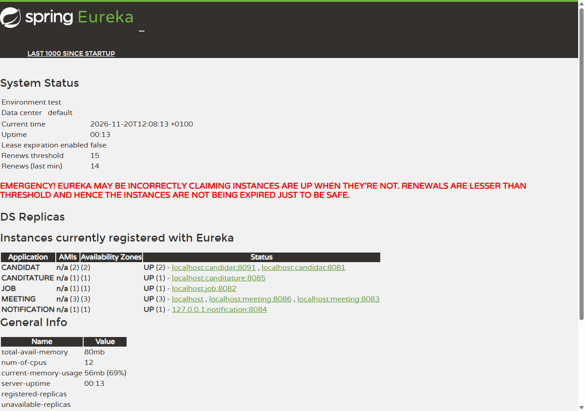

# Architecture Web Distribuée - Implémentation Eureka Server & Microservices

Ce projet implémente un registre de services distribué avec **Netflix Eureka** et intègre plusieurs microservices polyglottes (**Spring Boot**, **Node.js / Express**, **Python / FastAPI**) en tant que clients Eureka, avec support de passage à l'échelle (multi-instances).

---

## 👥 Membres de l'Équipe
- **Étudiant 1** : [Nom & Prénom]
- **Étudiant 2** : [Nom & Prénom]
- **Étudiant 3** : [Nom & Prénom]

---

## 🏗️ Architecture du Projet

Tous les microservices s'enregistrent auprès du même serveur Eureka (`http://localhost:8761`) et se découvrent dynamiquement par leur nom de service (`spring.application.name` / VIP address).

| Microservice | Technologie | Port par défaut | Nom dans Eureka | Rôle |
|---|---|---|---|---|
| **Eureka Server** | Spring Boot | `8761` | `EUREKA` | Registre de découverte des services |
| **Candidat** | Spring Boot + H2 | `8081` | `CANDIDAT` | Gestion des candidats et adresses |
| **Job** | Spring Boot + MySQL | `8082` | `JOB` | Gestion des offres d'emploi et catégories |
| **Candidature** | Spring Boot + MySQL | `8085` | `CANDIDATURE` | Gestion des candidatures |
| **Meeting** | Node.js / Express | `8083` | `MEETING` | Gestion des entretiens (multi-instance) |
| **Notification** | Python / FastAPI | `8084` | `NOTIFICATION` | Notifications (multi-instance) |

---

## ⚙️ Configuration & Réalisations

### 1. Eureka Server (Spring Boot)
- **Dépendance** : `spring-cloud-starter-netflix-eureka-server`
- **Annotation** : `@EnableEurekaServer` sur `EurekaApplication.java`
- **Configuration** (`src/main/resources/application.properties`) :
  ```properties
  spring.application.name=eureka
  server.port=8761
  eureka.client.register-with-eureka=false
  eureka.client.fetch-registry=false
  ```
- **Dashboard** accessible sur : [http://localhost:8761](http://localhost:8761)

---

### 2. Microservice Candidat (Spring Boot + H2)
- **Dépendance** : `spring-cloud-starter-netflix-eureka-client`
- **Annotation** : `@EnableDiscoveryClient` sur `CandidatApplication.java`
- **Configuration** (`src/main/resources/application.properties`) :
  ```properties
  spring.application.name=candidat
  server.port=8081
  eureka.client.service-url.defaultZone=http://localhost:8761/eureka
  eureka.client.register-with-eureka=true
  eureka.client.fetch-registry=true
  eureka.instance.prefer-ip-address=true
  ```
- **Multi-instances** :
  - Instance 1 : port `8081`
  - Instance 2 : port `8091` (`-Dserver.port=8091`)

---

### 3. Microservice Job (Spring Boot + MySQL)
- **Dépendance** : `spring-cloud-starter-netflix-eureka-client`
- **Annotation** : `@EnableDiscoveryClient` sur `JobApplication.java`
- **Configuration** (`src/main/resources/application.properties`) :
  ```properties
  spring.application.name=job
  server.port=8082
  eureka.client.service-url.defaultZone=http://localhost:8761/eureka
  eureka.client.register-with-eureka=true
  eureka.client.fetch-registry=true
  eureka.instance.prefer-ip-address=true
  ```

---

### 4. Microservice Meeting (Node.js / Express)
- **Client Eureka** : `eureka-js-client` (`npm install eureka-js-client`)
- **Configuration dynamique** : Lecture de la variable d'environnement `PORT` (défaut `8083`) et configuration du client Eureka dans `src/config/eureka.client.js`.
- **Enregistrement & Arrêt propre** :
  - Démarrage automatique du client Eureka à l'écoute du serveur HTTP (`eurekaClient.start()`).
  - Désenregistrement gracieux lors de l'arrêt (`SIGINT`/`SIGTERM`).
- **Endpoint de vérification** :
  - `GET http://localhost:8083/api/meetings/hello`
  - `GET http://localhost:8086/api/meetings/hello`
  - Swagger UI : `http://localhost:8083/swagger-ui`

---

### 5. Microservice Notification (Python / FastAPI)
- **Client Eureka** : `py-eureka-client` (`pip install py-eureka-client`)
- **Cycle de vie (Lifespan)** :
  - Enregistrement asynchrone au démarrage via `eureka_client.init_async`
  - Désenregistrement propre à l'arrêt via `eureka_client.stop_async`
  - Lecture du port dynamique depuis la variable d'environnement `PORT` (défaut `8084`)
- **Endpoint de vérification** :
  - `GET http://localhost:8084/api/notifications/hello`
  - Swagger UI : `http://localhost:8084/swagger-ui`

---

## 🚀 Guide de Démarrage Rapide

### Prérequis
- Java 17+ (JDK 17)
- Node.js 18+ & npm
- Python 3.10+
- MySQL / MariaDB (XAMPP sur port 3306 avec base `job_db`)

### Ordre d'exécution
1. **Démarrer Eureka Server** :
   ```powershell
   cd backend/backend/eureka
   ./mvnw spring-boot:run
   ```
2. **Démarrer Candidat (Instance 1 sur 8081 & Instance 2 sur 8091)** :
   ```powershell
   # Instance 1
   cd backend/backend/microservices/candidat
   ../../eureka/mvnw spring-boot:run

   # Instance 2
   ../../eureka/mvnw spring-boot:run -Dspring-boot.run.arguments=--server.port=8091
   ```
3. **Démarrer Job (Port 8082)** :
   ```powershell
   cd backend/backend/microservices/job
   ../../eureka/mvnw spring-boot:run
   ```
4. **Démarrer Meeting (Node.js - Instance 1 sur 8083 & Instance 2 sur 8086)** :
   ```powershell
   cd backend/backend/microservices/meeting
   npm install
   # Instance 1
   $env:PORT="8083"; npm start
   # Instance 2 (dans un autre terminal)
   $env:PORT="8086"; npm start
   ```
5. **Démarrer Notification (Python - Port 8084)** :
   ```powershell
   cd backend/backend/microservices/notification
   pip install -r requirements.txt
   python -m uvicorn app.main:app --host 0.0.0.0 --port 8084
   ```

---

## 📊 Tableau de Bord Eureka

Une fois tous les microservices lancés, accédez à [http://localhost:8761](http://localhost:8761).

La section **Instances currently registered with Eureka** affiche :
- **`CANDIDAT`** : 2 instances (ports `8081` et `8091`)
- **`JOB`** : 1 instance (port `8082`)
- **`CANDITATURE`** : 1 instance (port `8085`)
- **`MEETING`** : 2 instances (ports `8083` et `8086`)
- **`NOTIFICATION`** : 1 instance (port `8084`)


